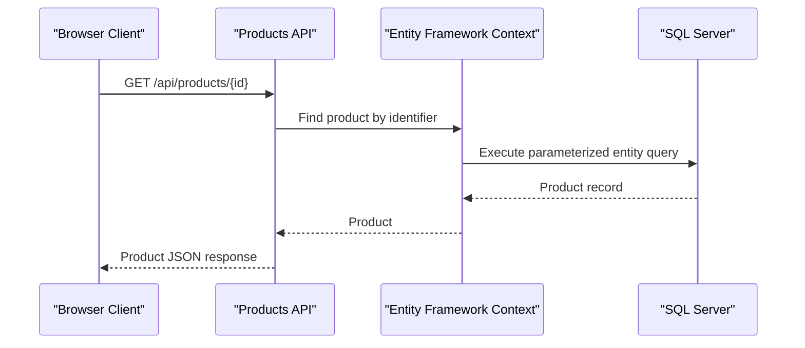

# API & Service Communication Contracts

The solution exposes MVC routes and attribute-routed Web API endpoints from one website service. Communication is synchronous HTTP/JSON, with one outbound recommendation request and no message-broker integration identified.

## Service Catalog

| Service | Port | Category | Purpose |
|---|---|---|---|
| PartsUnlimitedWebsite | Deployment-defined | API Layer | Serves MVC pages, Web API resources, and SignalR announcements |
| PartsUnlimitedDatabase | SQL Server port deployment-defined | Infrastructure | Provides the shared application and identity database |

## API Endpoints Inventory

| Service | Method | Path | Request Type | Response Type |
|---|---|---|---|---|
| PartsUnlimitedWebsite | GET | `/api/products` | Optional `sale` query parameter | Product list |
| PartsUnlimitedWebsite | GET | `/api/products/{id}` | `id` path parameter | Product |
| PartsUnlimitedWebsite | GET | `/api/raincheck` | None | Raincheck list |
| PartsUnlimitedWebsite | GET | `/api/raincheck/{id}` | `id` path parameter | Raincheck |
| PartsUnlimitedWebsite | POST | `/api/raincheck` | Raincheck JSON body | Integer result |
| PartsUnlimitedWebsite | GET | `/Store/Index` | None | HTML view |
| PartsUnlimitedWebsite | GET | `/Store/Browse?categoryId=...` | `categoryId` query parameter | HTML view |
| PartsUnlimitedWebsite | GET | `/Store/Details/{id}` | `id` path parameter | HTML view |
| PartsUnlimitedWebsite | GET | `/Search/Index?q=...` | `q` query parameter | HTML view |
| PartsUnlimitedWebsite | POST | `/Checkout/AddressAndPayment` | Order form | Redirect or checkout view |

MVC paths use the conventional `{controller}/{action}/{id}` route. The Web API uses the `api/{controller}/{id}` convention in addition to the attribute routes shown above.

## Management & Observability Endpoints

| Service | Endpoint | Custom Metrics |
|---|---|---|
| PartsUnlimitedWebsite | Swagger UI/documentation configured by Swashbuckle | None identified |
| PartsUnlimitedWebsite | SignalR hub route for `AnnouncementHub` | None identified |
| PartsUnlimitedWebsite | Health-check endpoint | None identified |

Application Insights telemetry calls are present in selected application flows; no custom metric registration was identified.

## DTOs & Contracts

The Web API returns domain types such as `Product` and `Raincheck`; the MVC UI uses view models including `ShoppingCartViewModel` and `OrderDetailsViewModel`. `Order` is the checkout form model. No immutable DTO convention, protobuf schema, GraphQL schema, or separate OpenAPI source file was identified; Swagger is configured in the application. Newtonsoft.Json handles JSON serialization and deserialization.

## Communication Patterns

- Browser-to-website communication uses synchronous HTTP requests; API responses are JSON and MVC responses are HTML.
- Controllers and query services use direct method calls and Entity Framework access to the shared SQL Server database.
- The recommendation engine makes a synchronous HTTP request to an Azure Machine Learning endpoint through an injected `HttpClient`.
- ASP.NET Identity uses OWIN cookie authentication and configured external OAuth providers. Checkout is protected with `[Authorize]`; the API controllers do not show explicit authorization attributes. TLS depends on deployment configuration and was not established from the source project.
- No message broker, service discovery, API gateway, retry policy, circuit breaker, or client-side load balancing was identified.

## Service Technology Matrix

| Service | Web | Data Access | Discovery | Gateway | Health | Cache | Metrics |
|---|---|---|---|---|---|---|---|
| PartsUnlimitedWebsite | MVC 5 and Web API 2 | Entity Framework 6 | None | None | None found | System.Runtime.Caching | Application Insights |
| PartsUnlimitedDatabase | SQL Server database project | SQL schema scripts | None | None | Not applicable | None | None |

## Service Communication Sequence

