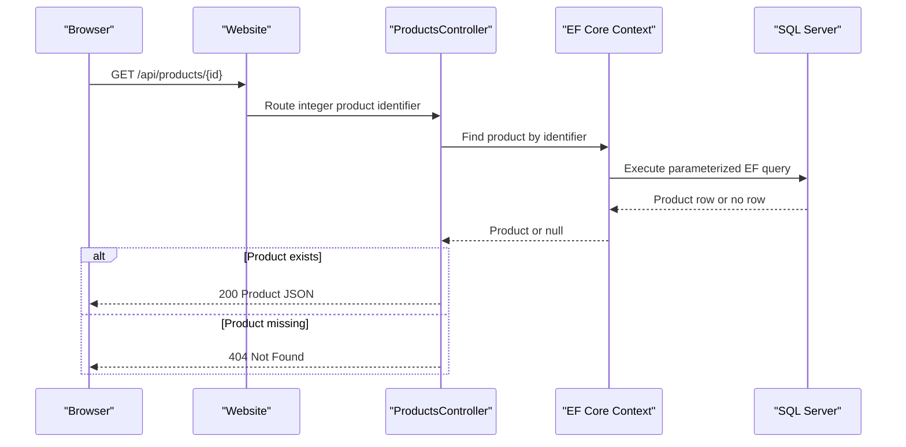

# API & Service Communication Contracts

The target contains 5 explicitly routed REST operations, a health endpoint, a SignalR hub, and conventionally routed MVC actions. Communication is synchronous HTTP/HTTPS, with one optional outbound recommendation request.

## Service Catalog

| Service | Port | Category | Purpose |
|---|---|---|---|
| Caldova-Asset-Manager.Website | Host-configured | API Layer and Business | Serves MVC pages, JSON endpoints, identity operations, and real-time announcements |
| Caldova-Asset-Manager.Database | SQL Server listener, externally configured | Infrastructure | ReadyRoll SQL project for the existing database schema and deployment scripts |
| Azure Machine Learning scoring endpoint | Externally configured | External integration | Returns product recommendations when enabled |

## API Endpoints Inventory

| Service | Method | Path | Request Type | Response Type |
|---|---|---|---|---|
| Website | GET | `/api/products` | Optional `sale` query parameter | `IList<Product>`; HTTP 200 |
| Website | GET | `/api/products/{id:int}` | Integer route parameter | `Product`; HTTP 200 or 404 |
| Website | GET | `/api/raincheck` | None | `IEnumerable<Raincheck>` |
| Website | GET | `/api/raincheck/{id:int}` | Integer route parameter | `Raincheck`; HTTP 200 or 404 |
| Website | POST | `/api/raincheck` | JSON `Raincheck` request body | Integer raincheck identifier |
| Website | GET | `/health` | None | Anonymous status object |
| Website | GET | `/favicon.svg` | None | SVG file |
| Website | GET | `/favicon.ico` | None | Redirect to `/favicon.svg` |
| Website | SignalR | `/signalr` | SignalR protocol messages | Hub messages from `AnnouncementHub` |
| Website | MVC | `/{controller=Home}/{action=Index}/{id?}` | Conventional route values and form/query data | Razor views, redirects, or JSON |
| Website | MVC Area | `/{area}/{controller=Orders}/{action=Index}/{id?}` | Conventional area route values | Administrative MVC responses |

API endpoints are not explicitly versioned. MVC action routes are conventional; account, cart, checkout, catalog, orders, and admin actions share the route templates above.

## Management & Observability Endpoints

| Service | Endpoint | Custom Metrics (if any) |
|---|---|---|
| Website | `GET /health` | No custom metrics; returns a basic running status |
| Website | Swagger/OpenAPI | No active Swagger registration or endpoint identified |
| Website | `/signalr` | SignalR hub transport; no custom metric registration identified |

## DTOs & Contracts

The API uses persistence model types (`Product` and `Raincheck`) directly for responses and the raincheck request body; no separate immutable API DTO or API-version contract was identified. `Product` contains a JSON-backed product-detail value that is materialized to a dictionary. MVC pages use view models such as `ProductViewModel`, `ShoppingCartViewModel`, and `OrderDetailsViewModel`. The active MVC JSON and SignalR configuration uses `System.Text.Json`, preserves property names, and ignores reference cycles; Newtonsoft.Json is used for model-level product-detail conversion. No protobuf or GraphQL schema was found.

## Communication Patterns

- Browser-to-website communication uses synchronous HTTP/HTTPS. Outside Development, the application enables HTTPS redirection and HSTS; TLS termination is deployment-host dependent.
- The recommendation engine makes a synchronous HTTPS request to a configured Azure ML endpoint. Its `HttpClient` has a 30-second timeout; no application-level retry or circuit breaker is configured.
- MVC checkout and admin operations use the local EF Core context. There are no separate business microservices, message brokers, or service-discovery clients.
- External identity providers are optional and activated by configuration. The product and raincheck API controllers have no controller-level authorization attribute; checkout and order controllers require an authenticated user, while admin actions require the configured administrator role.
- The database is configured through host settings. No API gateway or downstream response aggregation was identified.

## Service Technology Matrix

| Service | Web | Data Access | Discovery | Gateway | Health | Cache | Metrics |
|---|---|---|---|---|---|---|---|
| Website | ASP.NET Core MVC, API, SignalR | EF Core SQL Server | None | None | `/health` | In-process product cache | ILogger-backed telemetry adapter |
| Database | SQL Server schema project | SQL scripts and ReadyRoll | Not applicable | Not applicable | Host-managed | None identified | Not identified |

## Service Communication Sequence

