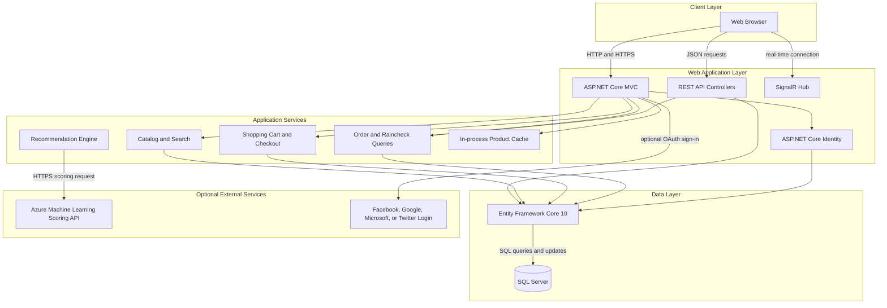
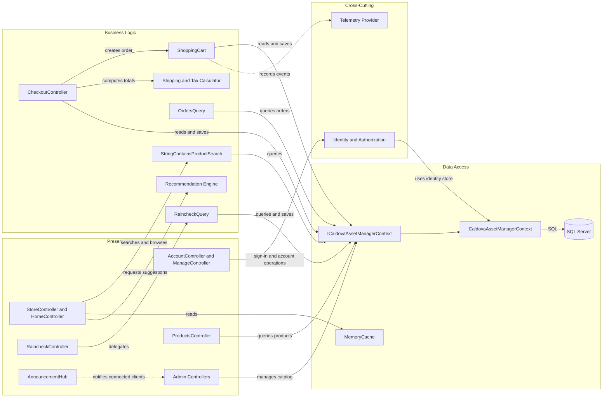

# Architecture Diagram

The application is a single web deployment for browsing and purchasing products, with a separate SQL database project. It exposes server-rendered pages, a small REST API, and a SignalR hub.

## Application Architecture

### Technology Stack Summary

| Layer | Technology | Version | Purpose |
|---|---|---:|---|
| Presentation | ASP.NET Core MVC and Razor | .NET 10 | Server-rendered shopping and administration pages |
| API | ASP.NET Core controllers | .NET 10 | Product and raincheck JSON endpoints |
| Real-time | ASP.NET Core SignalR | .NET 10 | Announcement hub |
| Identity | ASP.NET Core Identity | 10.0.0 | User accounts, password sign-in, and optional external login |
| Data access | Entity Framework Core SQL Server provider | 10.0.0 | Mapping and querying the existing SQL schema |
| Database | Microsoft SQL Server | Externally managed | Product, cart, order, identity, and raincheck persistence |
| Caching | System.Runtime.Caching | 10.0.0 | In-process caching of selected product views |
| Recommendation integration | Azure ML scoring endpoint | Externally configured | Optional product recommendations |

### Data Storage & External Services

The website uses one SQL Server database through EF Core. An optional Azure Machine Learning scoring API supplies product recommendations; external OAuth providers can also be enabled through configuration. No message broker, remote cache, or separate application service was found in the target workspace.

### Key Architectural Decisions

- The website is a single deployable application with MVC, API, and SignalR entry points.
- `ICaldovaAssetManagerContext` exposes EF Core data access to most controllers and query services.
- Database schema deployment is represented by a separate ReadyRoll SQL project; the website maps to existing tables.

## Component Relationships

### Component Inventory

| Component | Layer | Type | Responsibility |
|---|---|---|---|
| StoreController and HomeController | Presentation | MVC controllers | Browse catalog and render product lists |
| AccountController and ManageController | Presentation | MVC controllers | Sign-in, registration, and account management |
| Admin controllers | Presentation | Authorized MVC controllers | Maintain store products and administrative records |
| ProductsController | Presentation | API controller | Return product collections and individual products |
| RaincheckController | Presentation | API controller | Expose raincheck query and creation operations |
| AnnouncementHub | Presentation | SignalR hub | Provide real-time announcements |
| StringContainsProductSearch | Business Logic | Search service | Find products using a normalized text query |
| ShoppingCart | Business Logic | Domain service | Manage cart items and create order details |
| OrdersQuery | Business Logic | Query service | Retrieve order summaries and details |
| RaincheckQuery | Business Logic | Query service | Retrieve rainchecks and fill related product/store data |
| Recommendation Engine | Business Logic | Integration service | Request optional product recommendations |
| ICaldovaAssetManagerContext | Data Access | Data access abstraction | Expose entity sets and save operations |
| CaldovaAssetManagerContext | Data Access | EF Core DbContext | Map entities and identity data to SQL tables |
| Identity | Cross-Cutting | Authentication and authorization | Manage users, sign-in, and role checks |
| TelemetryProvider | Cross-Cutting | Logging adapter | Emit application events through `ILogger` |
