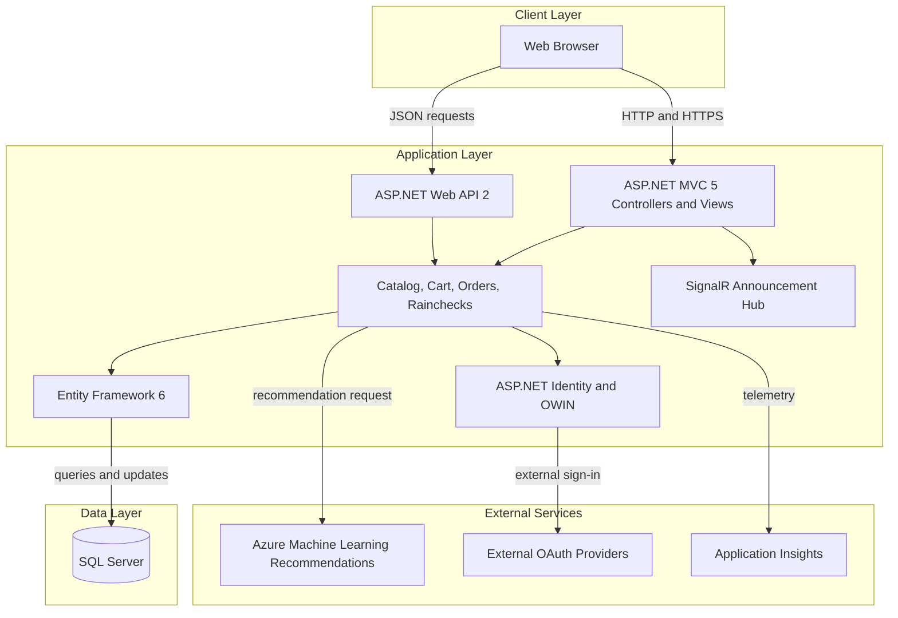
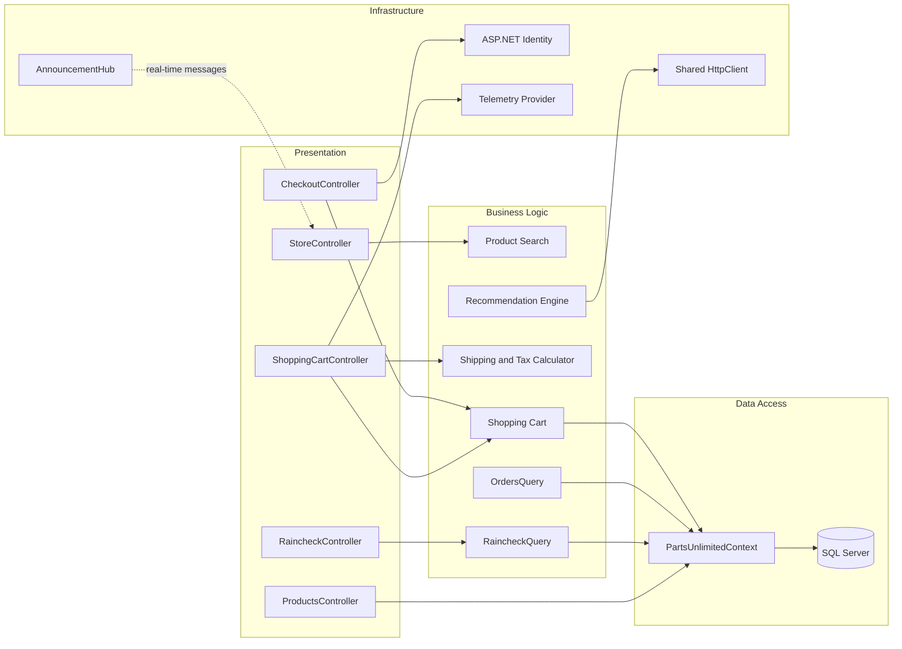

# Architecture Diagram

PartsUnlimited is a server-rendered retail web application with a companion Web API, a SQL Server data store, and an optional external recommendation service. The solution also contains Azure infrastructure and SQL database deployment projects.

## Application Architecture

### Technology Stack Summary

| Layer | Technology | Version | Purpose |
|---|---|---|---|
| Presentation | ASP.NET MVC | 5.2.3 | Server-rendered web UI |
| API | ASP.NET Web API | 5.2.3 | JSON endpoints |
| Identity | ASP.NET Identity with OWIN | 2.2.1 / 3.1.0 | User authentication and external sign-in |
| Real-time | ASP.NET SignalR | 2.2.2 | Announcement hub |
| Data access | Entity Framework | 6.1.3 | ORM and database access |
| Runtime | .NET Framework | 4.5.1 | Web application runtime |
| Database | SQL Server | Deployment-defined | Application and identity persistence |

### Data Storage & External Services

The website persists catalog, order, cart, raincheck, and identity data in SQL Server through Entity Framework. Recommendations can be requested from an Azure Machine Learning endpoint; OWIN authentication is configured for external OAuth providers, and telemetry is sent through the Application Insights provider.

### Key Architectural Decisions

- The application is a single web project with MVC and Web API surfaces sharing an Entity Framework context.
- Unity provides dependency injection for application services and the shared HTTP client.
- Database schema deployment is represented separately by a SQL project and deployment scripts.

## Component Relationships

### Component Inventory

| Component | Layer | Type | Responsibility |
|---|---|---|---|
| StoreController | Presentation | MVC controller | Displays product catalog and product details |
| ShoppingCartController | Presentation | MVC controller | Adds/removes cart items and presents totals |
| CheckoutController | Presentation | MVC controller | Creates and completes customer orders |
| ProductsController | Presentation | Web API controller | Returns product resources |
| RaincheckController | Presentation | Web API controller | Lists and creates rainchecks |
| ProductSearch | Business Logic | Search service | Searches products |
| ShoppingCart | Business Logic | Domain service | Manages a shopper's cart |
| DefaultShippingTaxCalculator | Business Logic | Calculator | Computes displayed shipping and tax totals |
| OrdersQuery | Business Logic | Query service | Retrieves order summaries and details |
| RaincheckQuery | Business Logic | Query service | Reads and writes rainchecks |
| PartsUnlimitedContext | Data Access | EF context | Persists application and identity entities |
| Recommendation Engine | Infrastructure | HTTP integration | Calls the configured recommendation service |
| AnnouncementHub | Infrastructure | SignalR hub | Publishes real-time announcements |
