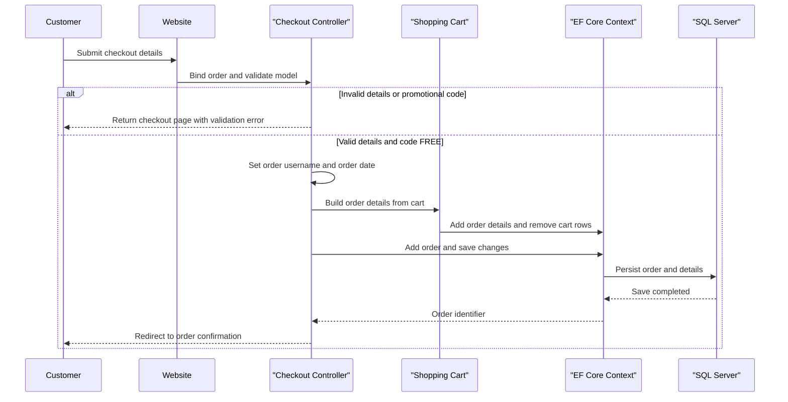

# Core Business Workflows

The application supports an online automotive-parts storefront with customer accounts, shopping carts, order checkout, store administration, and raincheck records. Catalog recommendations are an optional external enhancement to product browsing.

## Domain Entities

| Entity | Service / Bounded Context | Description | Key Relationships |
|---|---|---|---|
| Product | Catalog | Automotive part available for browsing and purchase | Belongs to a Category; appears in CartItems, OrderDetails, and Rainchecks |
| Category | Catalog | Groups related products | Contains Products |
| CartItem | Shopping Cart | Product quantity in a visitor's cart | References Product and cart identifier |
| Order | Checkout and Orders | Customer purchase with shipping/contact information and total | Contains OrderDetails; associated with a customer username |
| OrderDetail | Checkout and Orders | Product and quantity captured in an order | Belongs to an Order and references Product |
| ApplicationUser | Customer Accounts | Store customer identity and account information | Username is used to associate orders |
| Raincheck | Store Operations | Records an outstanding product purchase request | References Product and issuing Store |
| Store | Store Operations | Store that can issue a raincheck | Related to Rainchecks |

## Service-to-Domain Mapping

| Service | Domain Context | Owned Entities | External Dependencies |
|---|---|---|---|
| Caldova-Asset-Manager.Website | Catalog, Customer Accounts, Shopping Cart, Checkout, Store Operations | Product, Category, CartItem, Order, OrderDetail, ApplicationUser, Raincheck, Store | Shared SQL Server; optional Azure ML scoring endpoint; optional external login providers |
| Caldova-Asset-Manager.Database | Shared persistence schema | Tables for website entities and ASP.NET Identity | SQL Server deployment target |

The application is a single deployable service. Its feature areas share one database and the website is the source of truth for catalog, cart, order, and raincheck records.

## Primary Workflows

### Workflow 1: Browse and Search the Catalog

1. A visitor opens the storefront or submits a product search.
2. The MVC controller obtains products through the EF Core context or `StringContainsProductSearch`.
3. The application renders product views; selected product results may be served from the in-process cache.
4. If recommendations are enabled, the recommendation engine sends the product identifier to the configured HTTPS scoring endpoint and renders returned suggestions.

### Workflow 2: Add Products and Place an Order

1. A visitor adds a product to a session-associated cart; the website looks up the product and creates or increments its `CartItem`.
2. The authenticated customer submits checkout details. Model validation runs before order creation.
3. Checkout requires the configured promotional code `FREE`, case-insensitively; an invalid code returns the checkout view with an error.
4. The website assigns the order to the signed-in user, creates order details from the cart, clears cart rows, and saves the order through EF Core.
5. On order completion, the website checks that the requested order belongs to the current username before rendering its confirmation.

### Workflow 3: Manage Catalog and Rainchecks

Administrators with the configured admin role can manage product catalog records through MVC actions. Raincheck API operations delegate to `RaincheckQuery`, which loads related Product, Category, and Store information and persists new raincheck records.

## Cross-Service Data Flows

The only identified application-to-application data flow is the optional recommendation call: the website sends a model name and product identifier to the configured Azure ML endpoint and returns recommendation identifiers to the browser. The URI is required to be HTTPS and query values are URL escaped. No gateway aggregation, message-broker flow, or cross-service database access was found. If the recommendation request fails, the external call can fail the request; no circuit-breaker fallback was identified.

## Business Workflow Sequence

## Business Rules & Decision Logic

- Checkout requires an authenticated user and a valid order model; submitted username, order date, and total are controlled by server-side logic.
- The promotional code is the literal `FREE`, compared without case sensitivity.
- Order confirmation checks ownership by matching the order's username to the current identity.
- The default calculator charges five currency units per cart item and applies a 6% tax rate, with 7.5% for postal codes beginning with `98`.
- Product recommendations are disabled by default and require externally configured endpoint, model, and API-key settings when enabled.
- EF Core persists the order and related details in one `SaveChangesAsync` operation. No distributed transaction or saga is present.
- Admin catalog operations use role-based authorization; no separate business audit trail was identified.
