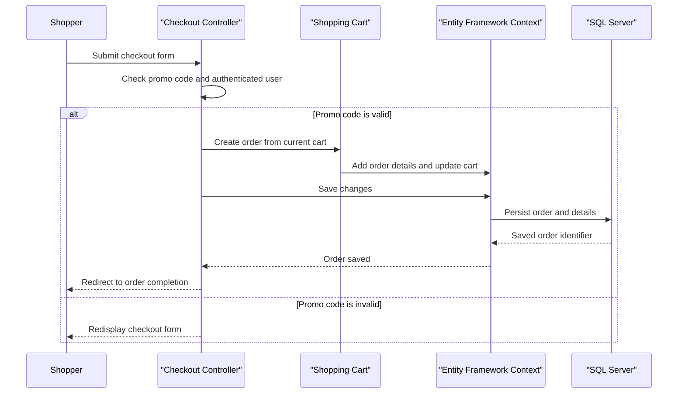

# Core Business Workflows

PartsUnlimited supports an online retail experience for browsing products, managing a shopping cart, and placing orders. Store administrators manage catalog and raincheck information, while an optional recommendation integration supplies related-product suggestions.

## Domain Entities

| Entity | Service / Bounded Context | Description | Key Relationships |
|---|---|---|---|
| Product | Catalog | A retail item offered for sale | Belongs to a Category; appears in OrderDetail and CartItem |
| Category | Catalog | A grouping of products | Contains Products |
| Order | Sales | A customer's submitted purchase | Contains OrderDetails and is associated with a user |
| OrderDetail | Sales | A product and quantity captured in an order | References an Order and Product |
| CartItem | Shopping Cart | A product selection in a user's cart | References a Product |
| ApplicationUser | Identity | A registered shopper or administrator | Can be associated with Orders |
| Raincheck | Store Operations | A record for a requested product/store item | References a Product and issuing Store |
| Store | Store Operations | A store location issuing rainchecks | Issues Rainchecks |

## Service-to-Domain Mapping

| Service | Domain Context | Owned Entities | External Dependencies |
|---|---|---|---|
| PartsUnlimitedWebsite | Catalog and shopping | Product, Category, CartItem | SQL Server |
| PartsUnlimitedWebsite | Sales and customer identity | Order, OrderDetail, ApplicationUser | SQL Server and ASP.NET Identity |
| PartsUnlimitedWebsite | Store operations | Raincheck, Store | SQL Server |
| Recommendation integration | Product recommendations | No local entity ownership | Azure Machine Learning endpoint |

The application is a single deployable website with a shared database; the contexts above are logical groupings, not separate services.

## Primary Workflows

### Workflow 1: Browse and add a product to the cart

1. A shopper opens the catalog or a category page.
2. The store controller queries products and categories through the shared EF context.
3. The shopper requests an add-to-cart action; the application resolves the product and current cart.
4. The cart updates its item collection and persists the change.
5. The cart summary is recalculated and returned to the shopper.

### Workflow 2: Submit an order

1. An authenticated shopper submits the checkout form.
2. The checkout controller checks the configured promo code and obtains the shopper identity from the authenticated principal.
3. The order and cart contents are associated, then saved through the shared context.
4. The shopper is redirected to an order-completion view that verifies the order belongs to that username.

### Workflow 3: Get product recommendations

1. A product page requests recommendations when the `ShowRecommendations` setting is enabled.
2. The recommendation engine calls the configured Azure Machine Learning endpoint with the product identifier.
3. Returned product identifiers are resolved against the local catalog and displayed as recommendations.

## Cross-Service Data Flows

There is no multi-service gateway aggregation. The recommendation integration sends a product identifier to an external Azure Machine Learning endpoint; the returned identifiers are matched against the website's SQL-backed product catalog. If the external request fails, the recommendation engine catches an HTTP request exception and yields an empty recommendation set.

## Business Workflow Sequence

## Business Rules & Decision Logic

- Checkout requires an authenticated user and the configured promo code; the checked-in implementation compares against a fixed demonstration code.
- The order username and date are assigned by the server, rather than accepted from the submitted form.
- The completion action queries by both order identifier and current username.
- Shipping is computed per item. The default calculator applies a standard tax rate with a different rate for postal codes beginning with `98`; a separate cart-removal response computes totals inline.
- Product and order model validation attributes constrain required fields and ranges; detailed persistence mappings are documented in `data-architecture.md`.
- Order persistence is performed through Entity Framework save operations. No cross-service transaction, message-based choreography, or business audit trail was identified.
