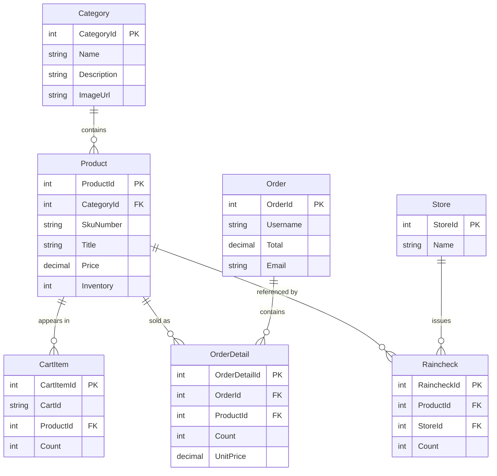

# Data Architecture & Persistence Layer

The application persists catalog, cart, order, identity, and raincheck data in one SQL Server database through EF Core. The website maps to an existing schema, while a separate SQL project contains schema deployment artifacts.

## Database Configuration

| Service/Module | DB Type | Profile | Driver | Connection | Migration Tool |
|---|---|---|---|---|---|
| Website | SQL Server | Host-selected runtime environment | EF Core SQL Server provider 10.0.0 | External `ConnectionStrings:DefaultConnectionString` or `SQLCONNSTR_DefaultConnectionString` | Existing database; no EF migration execution at startup |
| Database project | SQL Server | Debug / Release deployment configuration | SQL Server Data Tools schema provider | Deployment target supplied externally | ReadyRoll migration/deployment scripts |

The `CaldovaAssetManagerContext` maps entities to existing tables. The solution includes a legacy EF migration folder, but those sources are excluded from the active website compilation; the database project contains its own migration script.

## Data Ownership per Service

| Service | Tables Owned | ORM Framework | Caching | Notes |
|---|---|---|---|---|
| Website | Products, Categories, CartItems, Orders, OrderDetails, Rainchecks, Stores, ASP.NET Identity tables | EF Core 10 | In-process `MemoryCache` for selected product lists/details | One website owns the application data model |
| Database project | Shared schema for the website tables | SQL Server schema project | None | Deployment artifacts for the same database, not an independent service data store |

## Entity Model

`ApplicationUser` and the standard ASP.NET Identity role, claim, login, and user-role entities are also stored in the shared database. Orders are associated with usernames in application logic; the context does not configure a relational FK from `Order.Username` to the Identity user.

## Key Repository Methods

| Service | Repository | Notable Methods | Purpose |
|---|---|---|---|
| Website | `ICaldovaAssetManagerContext` / `CaldovaAssetManagerContext` (`Models/`) | Entity sets and `SaveChangesAsync` | Central EF Core data access abstraction used by most controllers and query services |
| Website | `OrdersQuery` (`Utils/OrdersQuery.cs`) | `GetOrdersAsync`, `GetOrderAsync`, query composition | Retrieves filtered order summaries and related details |
| Website | `RaincheckQuery` (`Utils/RaincheckQuery.cs`) | `GetAllAsync`, `FindAsync`, `AddAsync` | Retrieves, enriches, and creates rainchecks |
| Website | `StringContainsProductSearch` (`ProductSearch/`) | `Search` | Queries product titles using an EF Core LINQ predicate |

No separate repository interface hierarchy or raw SQL query implementation was identified in the active data-access path.

## Caching Strategy

Selected product data is cached in the process-wide `MemoryCache.Default` instance. Home page product lists use absolute 10-minute expiration; individual product entries use a 10-minute sliding expiration. Admin product updates invalidate selected product cache entries. The cache is local to each application process and is not distributed across instances; no cache-aside behavior is configured for the database context generally.

## Data Ownership Boundaries

The website and schema project share one SQL Server database. There is no database-per-service or cross-service database access pattern. The optional recommendation integration sends product identifiers to Azure ML, but does not transfer database ownership or query another service's data store. Most application data access uses the `ICaldovaAssetManagerContext` abstraction.

### Data Classification & Sensitivity

| Entity | Sensitive Fields | Classification (PII/PHI/PCI/None) | Controls in Place |
|---|---|---|---|
| ApplicationUser | Name, email, phone and account identity data | PII | Authentication and authorization apply; field-level encryption or masking is not configured in the application |
| Order | Name, address, city, state, postal code, phone, email, username | PII | Order access is checked against the signed-in username; application-level encryption-at-rest or masking is not configured |
| Product, Category, CartItem, OrderDetail, Raincheck, Store | Product and commerce data; cart identifier | None / operational data | No payment card data was identified; SQL Server storage protection is deployment-managed |
