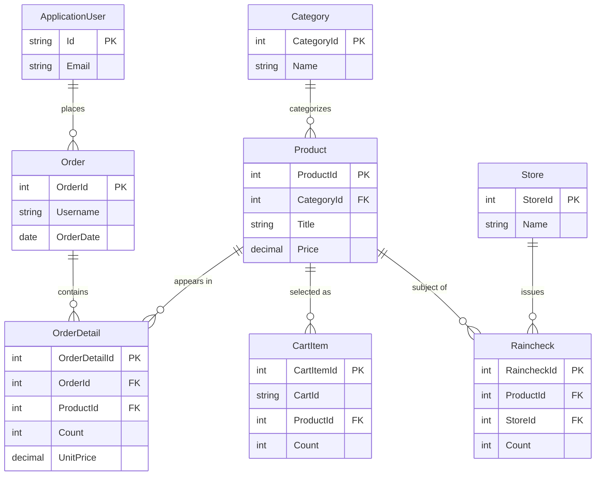

# Data Architecture & Persistence Layer

The data layer uses Entity Framework 6 over a shared SQL Server database. The website context contains retail and identity entities, while schema changes are also represented by a separate SQL database project.

## Database Configuration

| Service/Module | DB Type | Profile | Driver | Connection | Migration Tool |
|---|---|---|---|---|---|
| PartsUnlimitedWebsite | SQL Server | Default application configuration | EntityFramework.SqlServer | Named connection `DefaultConnectionString`; endpoint is deployment-defined | EF6 migrations |
| PartsUnlimitedDatabase | SQL Server | Deployment project | SQL Server Data Tools / ReadyRoll | Target set during deployment | ReadyRoll scripts and SQL migrations |

The EF context disables lazy loading. SQL deployment includes pre-deployment, post-deployment, and migration scripts; no other database profile was identified.

## Data Ownership per Service

| Service | Tables / Entities Owned | ORM Framework | Caching | Notes |
|---|---|---|---|---|
| PartsUnlimitedWebsite | Product, Category, Order, OrderDetail, CartItem, Raincheck, Store, ApplicationUser and Identity entities | Entity Framework 6 | In-process MemoryCache | One shared context and database |
| PartsUnlimitedDatabase | SQL schema and deployment artifacts | SQL Server database project | None | Schema deployment is separate from application queries |

## Entity Model

The model is concentrated in `PartsUnlimitedContext`; product/category, order/detail, cart/product, and raincheck/product/store relationships are represented through EF navigation properties and conventions. Order ownership by user is represented by username rather than a user navigation property.

## Key Repository Methods

| Service | Repository / Query Component | Notable Methods | Purpose |
|---|---|---|---|
| PartsUnlimitedWebsite | `OrdersQuery` (`Utils/OrdersQuery.cs`) | `IndexHelperAsync`, `FindOrderAsync` | Retrieves date/user-filtered orders and loads their details |
| PartsUnlimitedWebsite | `RaincheckQuery` (`Utils/RaincheckQuery.cs`) | `GetAllAsync`, `FindAsync`, `AddAsync` | Reads and creates rainchecks |
| PartsUnlimitedWebsite | `IPartsUnlimitedContext` (`Models/IPartsUnlimitedContext.cs`) | EF `IDbSet` properties and save operations | Shared data-access abstraction |

## Caching Strategy

The application uses `System.Runtime.Caching.MemoryCache` for selected product, latest-product, and top-selling-product data. Observed entries generally expire after ten minutes; the cache is process-local. No distributed cache, database second-level cache, or explicit cache-coordination mechanism was identified.

## Data Ownership Boundaries

The MVC and Web API surfaces share the same website project, context, and SQL Server database; there is no database-per-service or cross-service database access. The database project manages schema deployment, and EF query services provide data access for application flows. No CQRS or event-driven persistence boundary was identified.

### Data Classification & Sensitivity

| Entity | Sensitive Fields | Classification | Controls in Place |
|---|---|---|---|
| ApplicationUser | Email and identity credential data | PII / authentication data | ASP.NET Identity manages credential storage; field-level encryption or masking was not identified |
| Order | Name, address, city, state, postal code, phone, email | PII | No field-level encryption or masking was identified in the application model |
| CartItem | Cart identifier and associated product | User-linked data | No field-level controls identified |
| Product | Product descriptions and pricing | Business data | No sensitive personal data identified |

