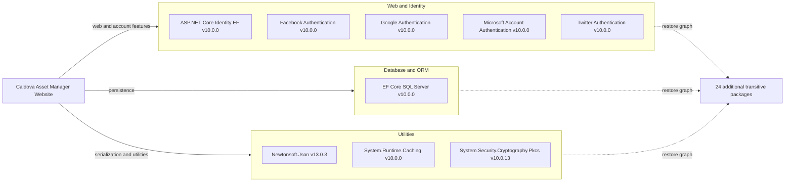

# Dependency Map

The active website project directly declares 9 NuGet packages; restore resolves 33 packages in total, including transitive dependencies. The legacy `packages.config` lists an older Framework-era stack but is removed from the current SDK project’s build items.

## Dependencies

### Dependency Summary

| Category | Count | Key Libraries | Notes |
|---|---:|---|---|
| Web and Identity | 5 | ASP.NET Core Identity EF, four external-login providers | Provider packages are used only when their configuration is enabled |
| Database and ORM | 1 | EF Core SQL Server | The target project resolves EF Core 10.0.0 |
| Utilities | 3 | Newtonsoft.Json, System.Runtime.Caching, PKCS | JSON conversion, in-process caching, and cryptographic primitives |

### Version & Compatibility Risks

The active `.csproj` targets .NET 10 and its direct packages resolve to .NET 10-compatible versions. The neighboring `packages.config` still contains an older .NET Framework dependency set (including older MVC, OWIN, and Newtonsoft.Json entries); it is excluded from the SDK project’s content and `None` items, so it was not included in the resolved dependency scan. Confirm that this legacy manifest is not used by a separate deployment workflow before treating it as active.

### Notable Observations

- The active graph contains 33 packages after restore; 24 are transitive to the 9 directly declared packages.
- Authentication-provider packages are installed even though each provider is disabled unless configured.
- The legacy package manifest contains a second, older dependency graph that differs from the active .NET 10 project.

## Test Dependencies

| Framework | Version | Notes |
|---|---|---|
| None in target project | — | No test-scoped package references were found in the website project |

Total test-scope dependencies: 0

The repository has a separate tests directory, outside the requested `IaaS2PaaSWeb` workspace scope. No test dependencies are included in this target-project inventory.
