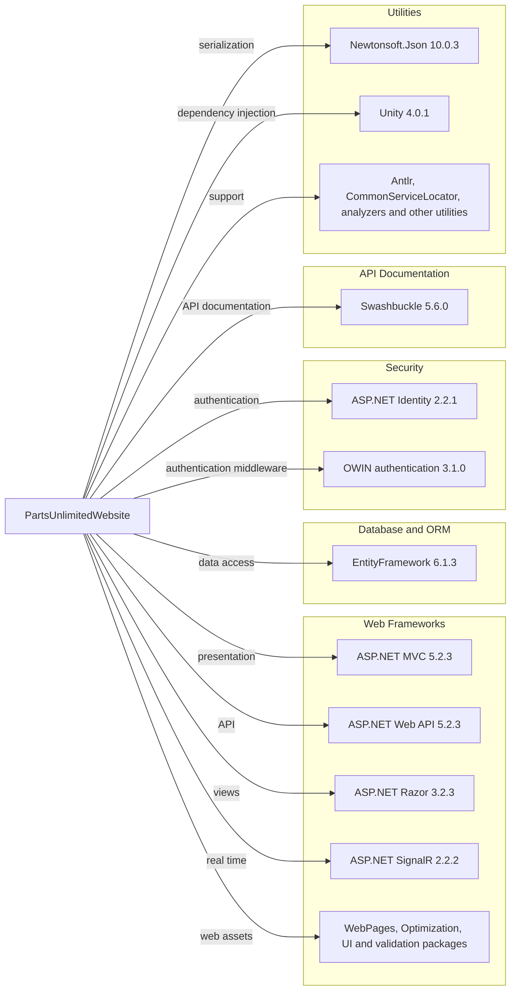

# Dependency Map

PartsUnlimitedWebsite declares 46 NuGet packages in `packages.config`; the solution also has a SQL Server database project. The diagram groups the main dependencies to remain readable.

## Dependencies

### Dependency Summary

| Category | Count | Key Libraries | Notes |
|---|---:|---|---|
| Web Frameworks and UI | 23 | ASP.NET MVC, Web API, Razor, SignalR | Classic System.Web application stack |
| Database / ORM | 1 | EntityFramework 6.1.3 | SQL Server provider referenced by the project |
| Security / Identity | 13 | ASP.NET Identity 2.2.1, OWIN 3.1.0 | Cookie and external-provider authentication |
| API Documentation | 2 | Swashbuckle 5.6.0 | Swagger documentation |
| Serialization | 1 | Newtonsoft.Json 10.0.3 | JSON conversion |
| Utilities | 6 | Unity 4.0.1, Antlr 3.5.0.2 | Dependency injection and supporting libraries |

### Version & Compatibility Risks

The application targets .NET Framework 4.5.1 and uses older ASP.NET MVC, Web API, OWIN, and Newtonsoft.Json packages. These versions are legacy and should be evaluated for support and compatibility as part of any runtime or framework modernization. The standard `dotnet list package` dependency-tree command could not load this legacy project on the current Linux host, so the inventory uses direct package declarations only.

### Notable Observations

- Package versions are pinned in `PartsUnlimitedWebsite/packages.config`; no lock file was found.
- Entity Framework 6 is used with a separate SQL Server database project and migration scripts.
- Swashbuckle and Web API expose an API-documentation surface.
- No test-scoped NuGet dependencies or separate test project were identified.

## Test Dependencies

| Framework | Version | Notes |
|---|---|---|
| None declared | — | No test-scoped NuGet dependencies were found in the target project. |

Total test-scope dependencies: 0

No test dependencies were detected in `packages.config`.
