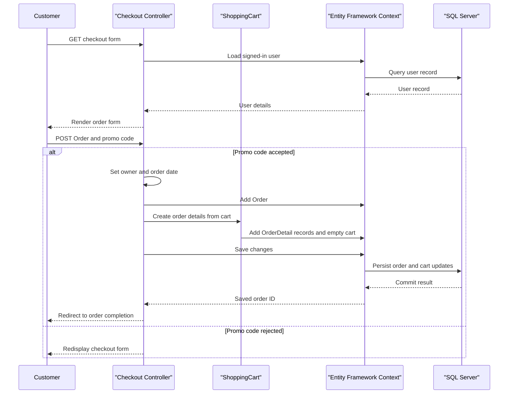

# API & Service Communication Contracts

The application exposes MVC page actions and a small JSON API, with synchronous in-process calls for application workflows. It also makes an outbound HTTP request to an Azure ML recommendation endpoint.

## Service Catalog

| Service | Port | Category | Purpose |
|---|---|---|---|
| PartsUnlimitedWebsite | Not declared; hosted by IIS/IIS Express | API Layer and Business | Storefront, administration, authentication, and product/raincheck endpoints |
| SQL Server LocalDB | Local configured connection | Infrastructure | Shared relational persistence for application and identity data |
| Azure ML recommendation endpoint | HTTPS | Infrastructure | External frequently-bought-together recommendations |

No separate independently deployable business service, API gateway, or message broker was identified.

## API Endpoints Inventory

MVC actions use the default `{controller}/{action}/{id}` route unless otherwise noted. Similar actions are grouped because the MVC surface contains more than 30 page and account-management actions.

| Service | Method | Path | Request Type | Response Type |
|---|---|---|---|---|
| PartsUnlimitedWebsite | GET | `/Home/Index` | None | `HomeViewModel` rendered as HTML |
| PartsUnlimitedWebsite | GET | `/Home/Recomendations` | None | HTML page |
| PartsUnlimitedWebsite | GET | `/Store/Index`, `/Store/Browse?categoryId={categoryId}` | Optional `categoryId` query parameter | Product listing HTML |
| PartsUnlimitedWebsite | GET | `/Store/Details/{id}` | Product ID path value | Product detail HTML |
| PartsUnlimitedWebsite | GET | `/Search/Index?q={query}` | Query parameter `q` | Search results HTML |
| PartsUnlimitedWebsite | GET | `/ShoppingCart/Index` | Session/cart context | Cart view model rendered as HTML |
| PartsUnlimitedWebsite | GET | `/ShoppingCart/AddToCart/{id}` | Product ID path value | Redirect to cart/store |
| PartsUnlimitedWebsite | POST | `/ShoppingCart/RemoveFromCart?id={id}` | Cart item ID and anti-forgery token | JSON `ShoppingCartRemoveViewModel` |
| PartsUnlimitedWebsite | GET / POST | `/Checkout/AddressAndPayment` | GET has no body; POST accepts `Order` and form promo code | Checkout HTML or redirect after order creation |
| PartsUnlimitedWebsite | GET | `/Checkout/Complete/{id}` | Order ID path value | Completion HTML, scoped to the signed-in user |
| PartsUnlimitedWebsite | GET | `/Orders/Index`, `/Orders/Details/{id}` | Optional date range or order ID | Order HTML |
| PartsUnlimitedWebsite | GET / POST | `/Account/{action}` | Account view models and token/query values | Sign-in, registration, confirmation, and password-flow HTML/redirects |
| PartsUnlimitedWebsite | GET / POST | `/Manage/{action}` | Account-management view models | Profile, phone, two-factor, and external-login HTML/redirects |
| PartsUnlimitedWebsite | GET / POST | `/Admin/{controller}/{action}/{id?}` | Controller/action-specific model or route values | Administrative HTML/redirects |
| PartsUnlimitedWebsite API | GET | `/api/products` | Optional query parameter `sale` (default `false`) | `IList<Product>` JSON |
| PartsUnlimitedWebsite API | GET | `/api/products/{id}` | Product ID path value | Product JSON (`200`) or `404` |
| PartsUnlimitedWebsite API | GET | `/api/raincheck` | None | `IEnumerable<Raincheck>` JSON |
| PartsUnlimitedWebsite API | GET | `/api/raincheck/{id}` | Raincheck ID path value | `Raincheck` JSON |
| PartsUnlimitedWebsite API | POST | `/api/raincheck` | `Raincheck` JSON body | Integer raincheck ID |

The Web API routes do not declare an explicit API version. MVC paths are governed by the conventional route configuration.

## Management & Observability Endpoints

| Service | Endpoint | Custom Metrics (if any) |
|---|---|---|
| PartsUnlimitedWebsite | `/swagger` (Swashbuckle UI/specification) | None identified |
| PartsUnlimitedWebsite | SignalR connection endpoint `/signalr` | None identified |
| PartsUnlimitedWebsite | Health/readiness endpoint | None identified |

Application telemetry is abstracted behind `ITelemetryProvider`; an operational metrics export endpoint was not found.

## DTOs & Contracts

The Web API serializes the `Product` and `Raincheck` domain entities directly; it does not use a gateway-level composition DTO. MVC requests use view models such as `LoginViewModel`, `RegisterViewModel`, and account-management models, while checkout accepts an `Order`. `ShoppingCartRemoveViewModel` and `OrderCostSummary` are response/presentation contracts. These are mutable classes rather than immutable records. Swashbuckle provides Swagger documentation, and Newtonsoft.Json is the JSON serialization library. No protobuf or GraphQL schema was found.

## Communication Patterns

MVC controllers call application services and query classes synchronously or asynchronously in-process, and the EF6 context accesses the shared SQL Server database. The recommendation engine uses an outbound HTTP GET to Azure ML, with model and product identifiers in the request; an `HttpRequestException` is tracked and degrades to an empty recommendation list. No retry, timeout policy, circuit breaker, service discovery, load balancing, message broker, or cross-service response aggregation was found.

ASP.NET Identity/OWIN provides cookie authentication, two-factor flows, and external sign-in configuration. MVC controllers protect account-management, checkout, order, and administrative actions with authorization attributes; administrative controllers require the admin role. The two Web API controllers do not declare authorization attributes and are publicly callable at the application layer. The code does not enforce HTTPS for inbound requests; TLS behavior depends on the hosting configuration.

## Service Technology Matrix

| Service | Web | Data Access | Discovery | Gateway | Actuator | Cache | Metrics |
|---|---|---|---|---|---|---|---|
| PartsUnlimitedWebsite | ASP.NET MVC 5 and Web API 2 | Entity Framework 6 | None | None | No health endpoint found | In-process `MemoryCache` | Telemetry abstraction; no metrics export found |
| SQL Server LocalDB | Relational database | SQL Server | N/A | N/A | N/A | N/A | N/A |
| Azure ML endpoint | External HTTPS API | External service-owned | Configured endpoint URL | N/A | N/A | N/A | N/A |

## Service Communication Sequence

