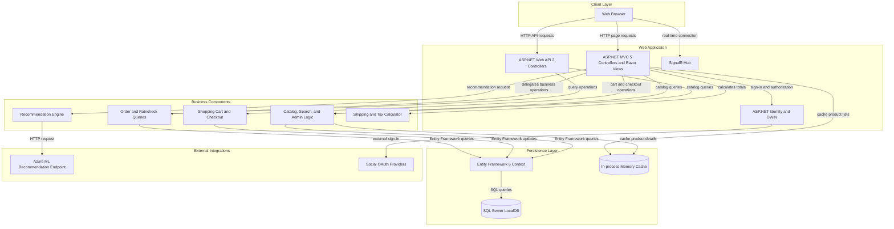
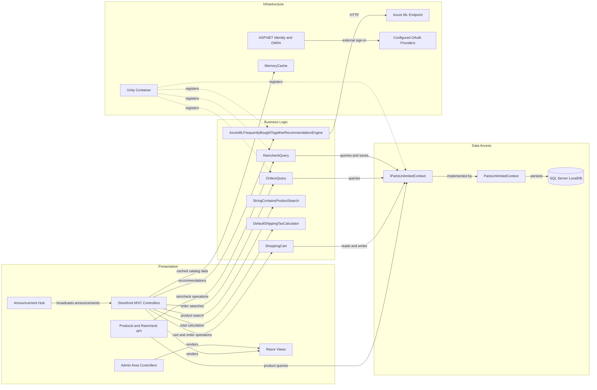

# Architecture Diagram

PartsUnlimited is a single ASP.NET web application with server-rendered storefront pages, a small Web API surface, and a shared Entity Framework data context. Business services and external integrations run in-process with the web application.

## Application Architecture

### Technology Stack Summary

| Layer | Technology | Version | Purpose |
|---|---|---:|---|
| Presentation | ASP.NET MVC | 5.2.3 | Server-rendered storefront and administrative pages |
| API | ASP.NET Web API | 5.2.3 | Product and raincheck JSON endpoints |
| Real-time | ASP.NET SignalR | 2.2.2 | Hub-based announcements |
| Authentication | ASP.NET Identity and OWIN | 2.2.1 / 3.1.0 | Cookie sign-in, user management, and configured external providers |
| Dependency injection | Unity | 4.0.1 | Registration and resolution of application components |
| Persistence | Entity Framework | 6.1.3 | ORM and SQL Server data access |
| Data store | SQL Server LocalDB | configured localdb | Relational application and identity data |
| Caching | `System.Runtime.Caching` | .NET Framework | In-process caching of product information |
| External recommendations | Azure ML HTTP endpoint | Endpoint-configured | Frequently-bought-together recommendations |

### Data Storage & External Services

The web application uses a single SQL Server LocalDB connection for storefront and ASP.NET Identity data. Product lists and details are cached in-process. The recommendation component calls an Azure ML endpoint over HTTP and uses configuration for its model name and account key; social sign-in providers are also configured through application settings. No message broker or separate internal service was identified.

### Key Architectural Decisions

- The application is a layered monolith with MVC and Web API presentation components sharing a single EF6 context.
- Unity wires interfaces such as `IPartsUnlimitedContext`, query services, and external-service wrappers.
- Recommendation failures handled as `HttpRequestException` return an empty recommendation list; no retry or circuit-breaker policy was identified.

## Component Relationships

### Component Inventory

| Component | Layer | Type | Responsibility |
|---|---|---|---|
| Storefront MVC Controllers | Presentation | MVC controllers | Browse products, search, manage carts, and check out |
| Admin Area Controllers | Presentation | MVC controllers | Manage products, customers, orders, and rainchecks |
| ProductsController | Presentation | Web API controller | Return product collections and individual products |
| RaincheckController | Presentation | Web API controller | Read and create raincheck records |
| AnnouncementHub | Presentation | SignalR hub | Provide real-time announcement communication |
| ShoppingCart | Business Logic | Domain service | Add/remove cart items, compute cart totals, and create order details |
| OrdersQuery | Business Logic | Query service | Filter orders and load associated details |
| RaincheckQuery | Business Logic | Query service | Read, populate, and persist rainchecks |
| StringContainsProductSearch | Business Logic | Search service | Search products by text |
| DefaultShippingTaxCalculator | Business Logic | Calculation service | Calculate shipping and tax totals |
| AzureMLFrequentlyBoughtTogetherRecommendationEngine | Business Logic | Integration service | Request product recommendations and handle service failures |
| IPartsUnlimitedContext | Data Access | Data abstraction | Expose entity sets and save operations |
| PartsUnlimitedContext | Data Access | EF6 DbContext | Map application and identity entities to SQL Server |
| Unity Container | Infrastructure | Dependency injection | Register and resolve application components |
| ASP.NET Identity and OWIN | Infrastructure | Authentication middleware | Manage user identities, cookies, external sign-in, and two-factor flows |
| MemoryCache | Infrastructure | In-process cache | Cache selected catalog data |
