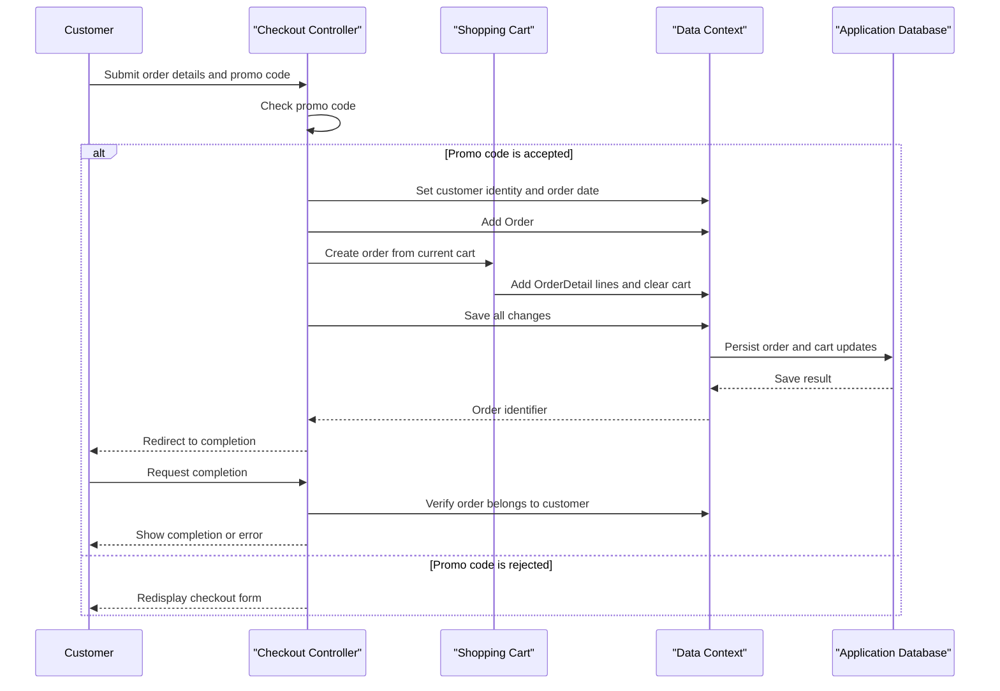

# Core Business Workflows

PartsUnlimited supports an online parts storefront with product discovery, a session-associated shopping cart, order checkout, customer accounts, and administrative catalog management. Product recommendations are optionally enriched by an external recommendation service.

## Domain Entities

| Entity | Service / Bounded Context | Description | Key Relationships |
|---|---|---|---|
| Product | PartsUnlimitedWebsite / Catalog | A part offered for sale with catalog, price, inventory, and recommendation data | Belongs to a Category; appears in order details, carts, and rainchecks |
| Category | PartsUnlimitedWebsite / Catalog | A grouping used to browse products | Contains Products |
| CartItem | PartsUnlimitedWebsite / Shopping | A product and quantity associated with a visitor's cart | References Product; grouped by a cart/session identifier |
| Order | PartsUnlimitedWebsite / Ordering | A customer's submitted purchase and delivery information | Contains OrderDetails and is associated with a signed-in username |
| OrderDetail | PartsUnlimitedWebsite / Ordering | A product line captured when a cart is checked out | References Order and Product |
| ApplicationUser | PartsUnlimitedWebsite / Identity | A registered storefront or administrative account | Identity data is used for sign-in and order ownership |
| Raincheck | PartsUnlimitedWebsite / Store Operations | A store-issued record for a product not currently available | References Product and issuing Store |
| Store | PartsUnlimitedWebsite / Store Operations | A store that issues rainchecks | Can issue multiple Rainchecks |

## Service-to-Domain Mapping

| Service | Domain Context | Owned Entities | External Dependencies |
|---|---|---|---|
| PartsUnlimitedWebsite | Catalog, Shopping, Ordering, Store Operations, and Identity | Product, Category, CartItem, Order, OrderDetail, Raincheck, Store, ApplicationUser | SQL Server database; optional Azure ML recommendation endpoint; configured social identity providers |

All domain contexts are implemented within one application and share the same database/context. The Azure ML integration returns recommendation identifiers; it does not own application entities or perform cross-service data aggregation.

## Primary Workflows

### Workflow 1: Add products to cart and check out

1. A visitor selects a product; the cart service locates the visitor's cart using the session-associated cart identifier.
2. The service increments an existing product line or adds a new cart item.
3. A signed-in customer submits shipping/order details and a promo code at checkout.
4. The checkout action accepts the configured `FREE` promo code case-insensitively; otherwise it redisplays the form.
5. On acceptance, the application assigns the signed-in username and current date, creates an Order and OrderDetails from cart contents, computes the order total, empties the cart, and saves the changes.
6. The completion action verifies that the requested order belongs to the signed-in username before displaying confirmation.

### Workflow 2: Administer the product catalog

An administrator with the required role can list, create, edit, or remove products. The application validates product models before saving changes, clears affected cached product data, and broadcasts a product announcement through SignalR after a successful creation.

### Workflow 3: Display product recommendations

When recommendations are enabled, the product detail view requests recommendation identifiers from the configured Azure ML endpoint. The application returns an empty recommendation list if the HTTP request fails or the response contains no recommendation set.

## Cross-Service Data Flows

There are no internal service-to-service data flows. The only identified outbound business-data exchange is the recommendation request: the application sends configured model information and a product identifier to Azure ML, then uses the returned product identifiers for recommendations. If the HTTP call fails, the recommendation list is empty; product browsing remains available. No retries, circuit breaker, or local recommendation persistence was found.

## Business Workflow Sequence

## Business Rules & Decision Logic

- **Checkout eligibility:** The submitted promo code must match `FREE` without case sensitivity; the checkout action is restricted to authenticated users. Although the `Order` model has data-annotation constraints, the checkout action does not explicitly gate persistence on `ModelState.IsValid`.
- **Order ownership:** Completion and order views scope customer access by the signed-in username; administrative order searches are separately role-protected.
- **Cart behavior:** Adding an existing product increments its quantity. Removing a line decrements quantities above one and deletes the line at one. Checkout snapshots each product's current price into an order detail, computes an order total, and empties the cart.
- **Catalog validation:** Product and order view models use data annotations for required values, lengths, ranges, and email/phone formats. The full persistence model and constraints are described in `data-architecture.md`.
- **Cost calculation:** The shared shipping/tax calculator charges per item and applies a standard tax rate with a different rate for postal codes beginning with `98`. The cart-removal response contains a separate displayed-total calculation, so its tax presentation may differ from the shared calculator.
- **Account rules:** ASP.NET Identity enforces the configured password and user rules, supports two-factor flows, and protects administrative operations through role authorization.
- **Transactions and side effects:** Order/cart changes are saved together through EF6 `SaveChangesAsync`; no distributed transaction or compensating workflow exists. Product creation emits a SignalR announcement after persistence. Checkout catches exceptions and redisplays the form rather than exposing the exception to the customer.
