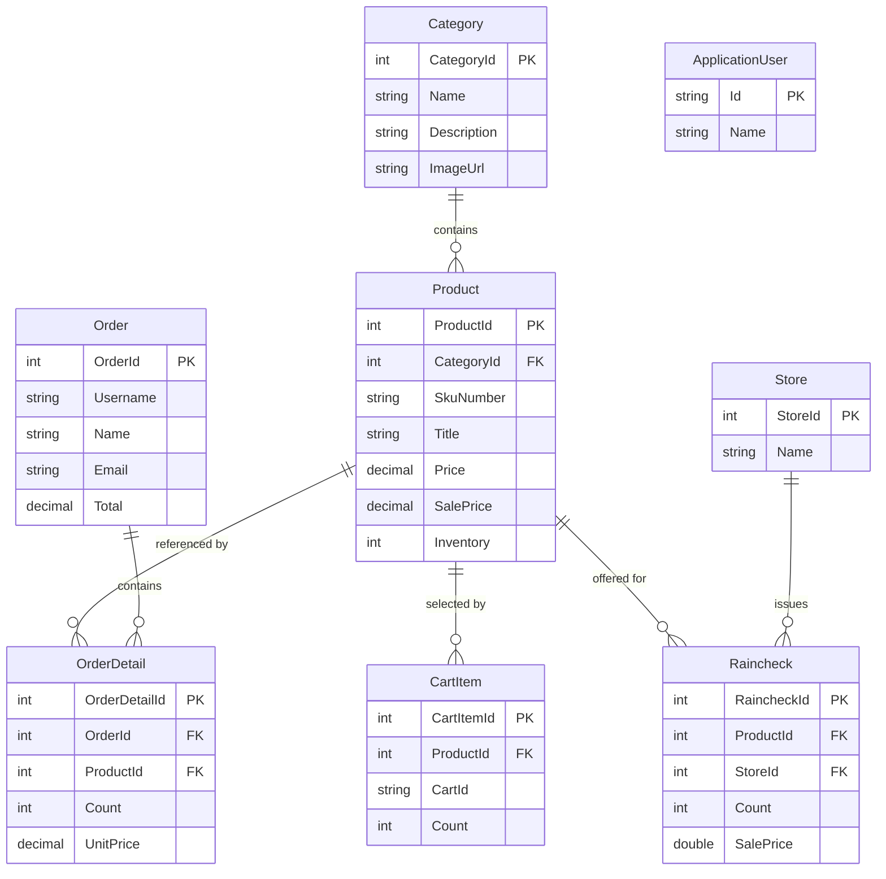

# Data Architecture & Persistence Layer

The application persists its catalog, shopping, order, raincheck, and identity data in a shared SQL Server database through Entity Framework 6. The model is maintained in one web-application bounded context rather than through separate service-owned stores.

## Database Configuration

| Service/Module | DB Type | Profile | Driver | Connection | Migration Tool |
|---|---|---|---|---|---|
| PartsUnlimitedWebsite | SQL Server LocalDB | Default development configuration | `System.Data.SqlClient` | `DefaultConnectionString` in `Web.config`; integrated authentication | EF6 migrations and a database initializer/seed routine |
| PartsUnlimitedWebsite | SQL Server | Debug/Release transforms | `System.Data.SqlClient` | No distinct environment connection definition was identified in the transforms | EF6 migrations |

The EF6 context disables lazy loading. The codebase includes an initial migration and a database initializer that seeds catalog data. No Flyway, Liquibase, or separate schema migration service was found.

## Data Ownership per Service

| Service | Tables Owned | ORM Framework | Caching | Notes |
|---|---|---|---|---|
| PartsUnlimitedWebsite | Products, categories, orders, order details, cart items, rainchecks, stores, application users, and ASP.NET Identity data | Entity Framework 6 | In-process `MemoryCache` for selected product data | One shared database and `PartsUnlimitedContext`; no service-specific schema boundary |

## Entity Model

Core entity sources: `Models/Category.cs`, `Models/Product.cs`, `Models/Order.cs`, `Models/OrderDetail.cs`, `Models/CartItem.cs`, `Models/Raincheck.cs`, `Models/Store.cs`, and `Models/ApplicationUser.cs`. `PartsUnlimitedContext.OnModelCreating` explicitly configures primary keys; navigation properties and conventional EF relationships connect products to categories, orders to order details, products to order details/cart items/rainchecks, and stores to rainchecks.

## Key Repository Methods

| Service | Repository | Notable Methods | Purpose |
|---|---|---|---|
| PartsUnlimitedWebsite | `OrdersQuery` (`Utils/OrdersQuery.cs`) | `IndexHelperAsync(username, start, end, invalidOrderSearch, isAdminSearch)` | Filters orders by date range and, when provided, username; loads order details and associated products |
| PartsUnlimitedWebsite | `OrdersQuery` (`Utils/OrdersQuery.cs`) | `FindOrderAsync(id)` | Finds an order and loads its details and products |
| PartsUnlimitedWebsite | `RaincheckQuery` (`Utils/RaincheckQuery.cs`) | `GetAllAsync()`, `FindAsync(id)` | Retrieves rainchecks and populates their store, product, and category navigation data |
| PartsUnlimitedWebsite | `RaincheckQuery` (`Utils/RaincheckQuery.cs`) | `AddAsync(raincheck)` | Adds a raincheck and saves changes |
| PartsUnlimitedWebsite | `IPartsUnlimitedContext` (`Models/IPartsUnlimitedContext.cs`) | Entity sets, `SaveChangesAsync`, and `Entry` | Shared data-access abstraction used by controllers and query services |

The query classes provide selected data operations, while many controllers also query entity sets on the shared context directly. No separate generic repository framework or raw SQL query method was identified.

## Caching Strategy

The application uses the process-local `MemoryCache.Default`; no distributed cache is configured. The home page caches top-selling and new-arrival product lists for 10 minutes, product details use a 10-minute sliding expiration, and selected latest-product data is cached for 10 minutes. Administrative create/edit/delete actions remove relevant entries. Cache state is local to each web process.

## Data Ownership Boundaries

All domain and identity entities are owned by the single PartsUnlimitedWebsite application and share the same SQL Server database/context. There is no database-per-service or cross-service database access. Controllers and query services perform in-process LINQ-to-Entities queries; the Azure ML recommendation integration exchanges product identifiers over HTTP but does not share the application database. The application does not implement CQRS or an outbox pattern.

### Data Classification & Sensitivity

| Entity | Sensitive Fields | Classification (PII/PHI/PCI/None) | Controls in Place |
|---|---|---|---|
| Order | Name, address, city, state, postal code, country, phone, and email | PII | No field-level encryption or masking was identified in the application model; transport/storage protections depend on hosting and database configuration |
| ApplicationUser | Identity username/email and profile name | PII | ASP.NET Identity manages password hashes; no field-level encryption or masking for profile data was identified |
| Product, Category, CartItem, OrderDetail, Raincheck, Store | No direct PII/PHI/PCI fields identified in these model classes | None identified | No additional field-level controls identified |
