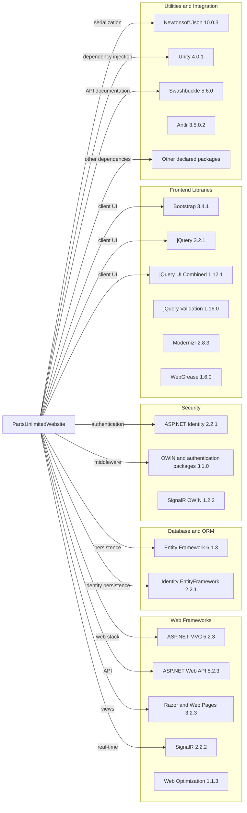

# Dependency Map

The `PartsUnlimitedWebsite` project declares 46 NuGet dependencies in `packages.config`. The diagram groups related framework components to keep the graph legible; the summary lists the important packages and versions.

## Dependencies

### Dependency Summary

| Category | Count | Key Libraries | Notes |
|---|---:|---|---|
| Web Frameworks | 12 | ASP.NET MVC 5.2.3, Web API 5.2.3, Razor/Web Pages 3.2.3, SignalR 2.2.2, Web Optimization 1.1.3 | Classic System.Web web stack |
| Database / ORM | 2 | Entity Framework 6.1.3, Microsoft.AspNet.Identity.EntityFramework 2.2.1 | EF6 over SQL Server; Identity uses the same context |
| Security | 13 | ASP.NET Identity 2.2.1, Microsoft.Owin 3.1.0, OWIN Security providers 3.1.0 | Includes cookie, OAuth, and provider-specific packages |
| Frontend Libraries | 9 | Bootstrap 3.4.1, jQuery 3.2.1, jQuery UI Combined 1.12.1, jQuery Validation 1.16.0, Modernizr 2.8.3 | Legacy browser-side dependency set |
| Utilities | 10 | Newtonsoft.Json 10.0.3, Unity 4.0.1, Swashbuckle 5.6.0, Antlr 3.5.0.2, CommonServiceLocator 1.3 | Includes dependency injection, Swagger, and supporting packages |

### Version & Compatibility Risks

The application targets .NET Framework 4.5.1 and uses older ASP.NET, OWIN, and JavaScript packages. The dependency scan found high-severity advisories for Newtonsoft.Json 10.0.3, Microsoft.AspNet.Identity.Owin 2.2.1, Microsoft.Owin 3.1.0, Microsoft.Owin.Security.Cookies 3.1.0, and jQuery.Validation 1.16.0; see the security findings for advisory details. `dotnet list package --include-transitive` could not evaluate this legacy Web Application project because the Visual Studio WebApplication MSBuild targets are unavailable on this Linux runner, so the dependency inventory is based on the direct declarations in `packages.config`.

### Notable Observations

- `packages.config` is the package manifest; no lock file or central package version file was found.
- Framework components are split across separate NuGet packages, including several OWIN and SignalR packages that share version lines.
- The main project has no declared test-scoped packages.

## Test Dependencies

| Framework | Version | Notes |
|---|---|---|
| None detected | — | No test-scoped dependencies are declared in `packages.config`. |

Total test-scope dependencies: 0

No test dependencies were detected in the project package manifest.
