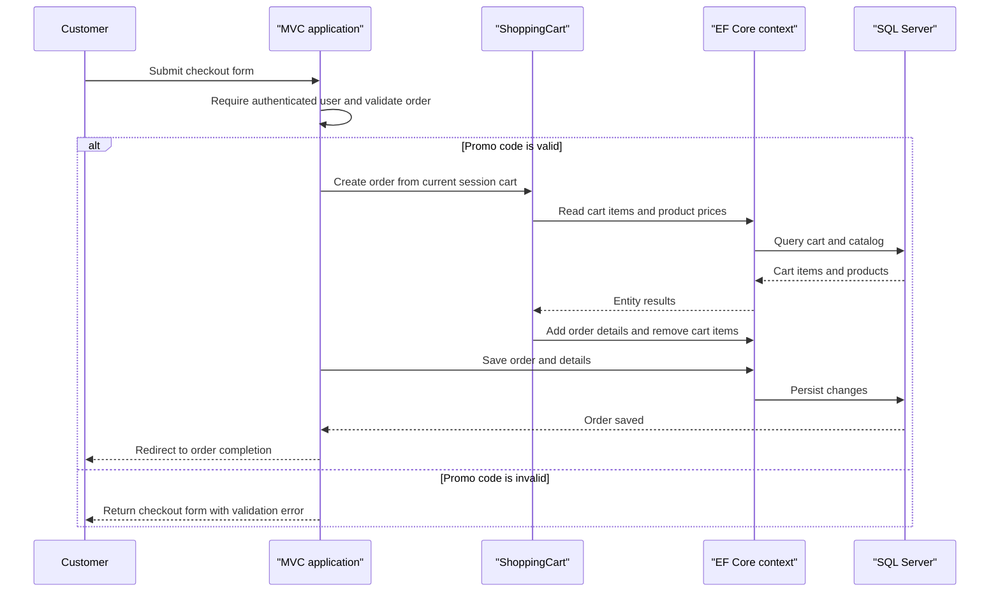

# API & Service Communication Contracts

Caldova Asset Manager exposes a small JSON API alongside conventional MVC routes and a SignalR hub. Internal operations use direct service and EF Core calls; optional external calls are synchronous HTTP, SMTP, and OAuth.

## Service Catalog

| Service | Port | Category | Purpose |
|---|---|---|---|
| Caldova-Asset-Manager.Website | Host-configured | API Layer and Business | Single deployable storefront, account, admin, API and real-time application |
| SQL Server | Host-configured | Infrastructure | Stores commerce and identity records |
| Azure ML scoring endpoint | HTTPS, configured | External integration | Optional product recommendations |
| SMTP server | Configured | External integration | Sends account confirmation, reset and two-factor messages |
| Facebook, Google, Microsoft and Twitter | Provider-configured | External identity | Optional OAuth sign-in |

## API Endpoints Inventory

| Service | Method | Path | Request Type | Response Type |
|---|---|---|---|---|
| Website API | GET | `/api/products` | Optional `sale` query boolean | `IList<Product>` |
| Website API | GET | `/api/products/{id}` | Integer path parameter | `Product` or 404 |
| Website API | GET | `/api/raincheck` | None | `IEnumerable<Raincheck>` |
| Website API | GET | `/api/raincheck/{id}` | Integer path parameter | `Raincheck` or 404 |
| Website API | POST | `/api/raincheck` | JSON `Raincheck` body | New integer identifier |
| Website hosting | GET | `/health` | None | Status JSON; anonymous |
| Website hosting | GET | `/favicon.svg`, `/favicon.ico` | None | Static SVG or redirect |
| Website MVC | GET/POST | `/{controller}/{action}/{id?}` | Controller-specific route/query/form values; account and checkout forms use view models/entities | Razor view, redirect or action-specific result |
| Website real time | SignalR | `/signalr` | Hub protocol messages | Announcement hub messages |

The MVC application uses conventional routes rather than API versioning. The controller actions include catalog browsing, cart and checkout, orders, account management, authentication, and administration; this inventory groups these routes by the conventional template.

## Management & Observability Endpoints

| Service | Endpoint | Custom Metrics (if any) |
|---|---|---|
| Website | `GET /health` | None |

No active metrics-export endpoint was identified. A legacy Swagger configuration source exists but is excluded from the current SDK project compilation.

## DTOs & Contracts

The JSON API returns the `Product` and `Raincheck` domain models directly and accepts a `Raincheck` request body. MVC account operations use request view models such as `LoginViewModel`, `RegisterViewModel`, and `ResetPasswordViewModel`; checkout binds an `Order`. `OrderDetailsViewModel` and `ProductViewModel` are presentation response models. No gateway aggregation DTO, active OpenAPI document, protobuf schema, or GraphQL schema was found. JSON is configured with System.Text.Json for MVC/SignalR, while Newtonsoft.Json is used for product details and recommendation responses.

## Communication Patterns

Controllers call application services synchronously; EF Core performs database operations through the shared context. The optional recommendation integration uses an HTTPS scoring endpoint with a 30-second HttpClient timeout and no retry or circuit-breaker policy. Account email is sent synchronously through configured SMTP with TLS enabled. External sign-in uses provider middleware; there is no service discovery, API gateway, asynchronous broker, or cross-service aggregation.

Cookie authentication is provided by ASP.NET Core Identity, with authorization attributes on account management, checkout, orders and admin controllers. The JSON product and raincheck API controllers do not declare authorization attributes. Production hosting enables HTTPS redirection and HSTS; development does not enable those middleware components. Database transport security depends on the externally supplied connection string.

## Service Technology Matrix

| Service | Web | Data Access | Discovery | Gateway | Health | Cache | Metrics |
|---|---|---|---|---|---|---|---|
| Website | ASP.NET Core MVC, controllers and SignalR | EF Core SQL Server | None | None | `/health` | In-process MemoryCache and session | ILogger-backed telemetry; no export endpoint |

## Service Communication Sequence

