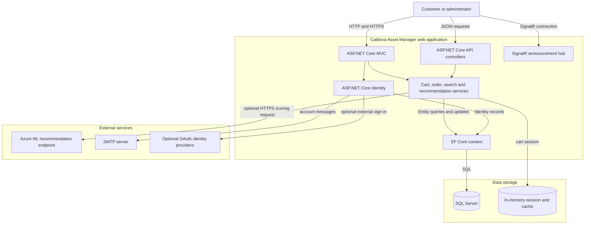
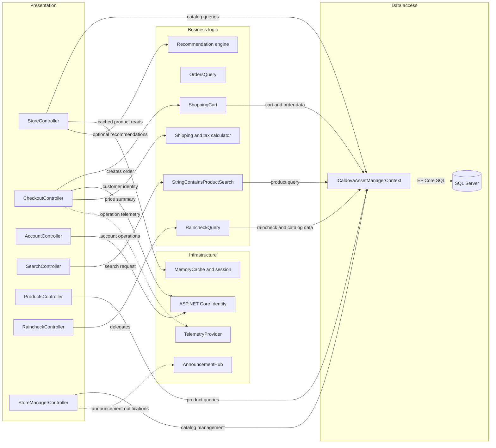

# Architecture Diagram

Caldova Asset Manager is a single ASP.NET Core web application that serves an MVC storefront, JSON endpoints, and real-time announcements. It uses one EF Core context for SQL Server and optionally calls external recommendation and email services.

## Application Architecture

### Technology Stack Summary

| Layer | Technology | Version | Purpose |
|---|---|---|---|
| Presentation | ASP.NET Core MVC and Razor | .NET 10 | Storefront, account and administration pages |
| API and real time | ASP.NET Core controllers and SignalR | .NET 10 | Product/raincheck JSON endpoints and announcements |
| Identity | ASP.NET Core Identity | 10.0.0 | User accounts, cookie authentication and optional social sign-in |
| Persistence | Entity Framework Core SQL Server provider | 10.0.0 | Application and identity persistence |
| Runtime | .NET | 10.0; runtime framework 10.0.13 | Application execution |
| External calls | HttpClient and SMTP | .NET 10 | Optional recommendations and account email |

### Data Storage & External Services

The application stores commerce and identity data in a configured SQL Server database. Session state and `System.Runtime.Caching` use in-process memory. Recommendations can call a configured HTTPS scoring endpoint, account messages use SMTP, and external OAuth providers are optional; none of those external services are required for the default disabled recommendation configuration.

### Key Architectural Decisions

- One deployable web application owns MVC, API, identity, persistence, and SignalR concerns.
- EF Core accesses SQL Server through the shared `ICaldovaAssetManagerContext`; focused order and raincheck query services provide selected read/write operations.
- Recommendation and social-login integrations are configuration-gated; there is no message broker or service-discovery component.

## Component Relationships

### Component Inventory

| Component | Layer | Type | Responsibility |
|---|---|---|---|
| StoreController | Presentation | MVC controller | Displays categories and products |
| CheckoutController | Presentation | MVC controller | Validates and places customer orders |
| AccountController | Presentation | MVC controller | Registration, sign-in, email and two-factor flows |
| ProductsController | Presentation | API controller | Reads product catalog data |
| RaincheckController | Presentation | API controller | Reads and creates rainchecks |
| StoreManagerController | Presentation | Admin MVC controller | Manages products and sends announcements |
| ShoppingCart | Business logic | Domain service | Maintains session-associated cart items and creates order lines |
| OrdersQuery | Business logic | Query service | Retrieves orders and line-item details |
| RaincheckQuery | Business logic | Query service | Retrieves, enriches and creates rainchecks |
| StringContainsProductSearch | Business logic | Search service | Searches products by title |
| Recommendation engine | Business logic | Integration service | Fetches optional recommendations |
| ICaldovaAssetManagerContext | Data access | EF Core abstraction | Exposes application and identity data sets |
| TelemetryProvider | Infrastructure | Singleton service | Sends application events to the configured logger |
| AnnouncementHub | Infrastructure | SignalR hub | Publishes administrator announcements |
