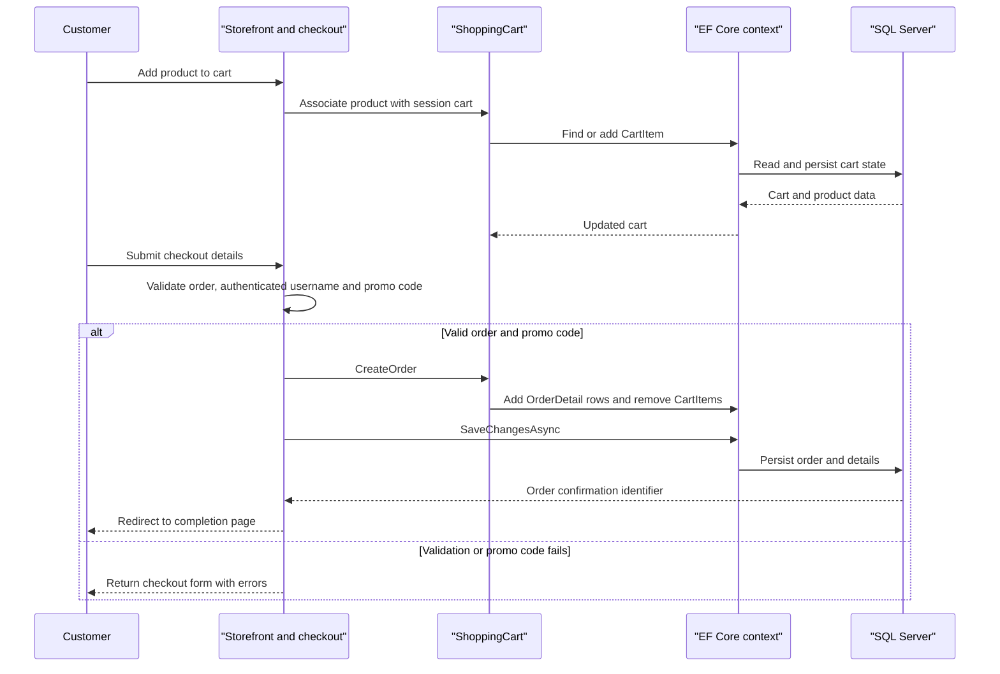

# Core Business Workflows

Caldova Asset Manager supports an online storefront with product discovery, session-associated shopping carts, authenticated checkout, customer accounts, and store-issued rainchecks. Administrators manage catalog content and can notify connected clients about announcements.

## Domain Entities

| Entity | Service / Bounded Context | Description | Key Relationships |
|---|---|---|---|
| Product | Storefront catalog | Item available for browsing and sale | Belongs to a Category; appears in CartItems, OrderDetails and Rainchecks |
| Category | Storefront catalog | Groups products for browsing | Contains Products |
| CartItem | Shopping cart | Product and quantity associated with a session cart | References Product |
| Order | Checkout and orders | Customer-submitted purchase and delivery details | Contains OrderDetails; username associates it with an account |
| OrderDetail | Checkout and orders | Purchased product, quantity and unit-price snapshot | References Order and Product |
| ApplicationUser | Account management | Customer identity and authentication account | Orders are associated by username; Identity stores credentials and claims |
| Raincheck | Store operations | Store-issued claim for a product and sale price | References Product and issuing Store |
| Store | Store operations | Store identity | Issues Rainchecks |

## Service-to-Domain Mapping

| Service | Domain Context | Owned Entities | External Dependencies |
|---|---|---|---|
| Caldova-Asset-Manager.Website | Catalog and storefront | Product, Category, CartItem | SQL Server |
| Caldova-Asset-Manager.Website | Checkout and orders | Order, OrderDetail | SQL Server; optional SMTP for account-related messages |
| Caldova-Asset-Manager.Website | Accounts | ApplicationUser and ASP.NET Identity records | SQL Server; optional OAuth providers |
| Caldova-Asset-Manager.Website | Store operations | Raincheck, Store | SQL Server |
| Caldova-Asset-Manager.Website | Recommendations | No separate owned entity; returned IDs map to Product | Optional Azure ML scoring endpoint |

All bounded contexts are modules in one application and share the same EF Core context and SQL Server database; no inter-service event or REST exchange exists between them.

## Primary Workflows

### Workflow 1: Browse Catalog and Search

1. A visitor opens the storefront or selects a category.
2. The Store controller reads categories/products through the shared context and may serve cached product/catalog results.
3. Search submits a query to `StringContainsProductSearch`, which matches normalized product titles and returns matching Products.
4. If recommendations are enabled, the application asks the configured scoring endpoint for product identifiers and maps those identifiers to local Product records. The recommendation request has a 30-second HTTP timeout; a failed external request can propagate to the caller.

### Workflow 2: Add Items and Place an Order

1. A visitor adds a product to a cart. The application creates or updates a `CartItem` associated with a session-generated cart identifier.
2. The cart page loads product details and computes subtotal, shipping, tax and total for display.
3. An authenticated customer submits checkout details. The application assigns the username and date from the authenticated session, validates the order model, and checks the submitted promo code against the configured application constant `FREE` (case-insensitive).
4. On success, the cart is converted to OrderDetail rows using current product prices, the order total is calculated, and cart rows are removed. A single EF Core `SaveChangesAsync` persists the order and related changes.
5. The customer is redirected to completion; order access is checked against the signed-in username.

### Workflow 3: Register and Sign In

1. A visitor registers with an email and password, and ASP.NET Core Identity creates the account.
2. The application sends an email confirmation message through configured SMTP.
3. The customer confirms the account and may sign in using a password, two-factor email code, or an enabled external OAuth provider.
4. Password reset and account-management actions use Identity’s token and password APIs.

### Workflow 4: Create a Raincheck

An API caller posts a Raincheck JSON model. The raincheck query service persists it and returns its generated identifier. Read operations enrich rainchecks with associated product/category and issuing-store data; the admin screen lists those records.

## Cross-Service Data Flows

The website is a single deployable service, so catalog, cart, order, account and raincheck flows exchange entities through the shared EF Core context rather than network calls. Optional recommendation composition is the only application-data exchange with another service: the scoring endpoint returns recommendation identifiers, which the website resolves to local Product records. There is no configured circuit breaker or fallback response; a failed scoring call is not converted into an empty recommendation list by the current engine.

## Business Workflow Sequence

## Business Rules & Decision Logic

- Product input uses required, length and range validation attributes; checkout requires customer/address fields and assigns order date and username server-side.
- Checkout accepts the fixed `FREE` promo code case-insensitively; other values return a validation error.
- Order details preserve the product price used when creating the order; the order total is the sum of quantity multiplied by unit price.
- Cart identity is stored in the ASP.NET Core session; adding an existing product increments its count, and removing decrements it or deletes the cart row.
- A customer may view only their own order details; admin controller access is role-authorized.
- EF Core persists order, detail and cart cleanup in one `SaveChangesAsync` operation. No explicit distributed transaction or saga is present.
- Recommendation behavior is conditional on `ShowRecommendations`; no retry, fallback, or compensation is configured for scoring failures.
