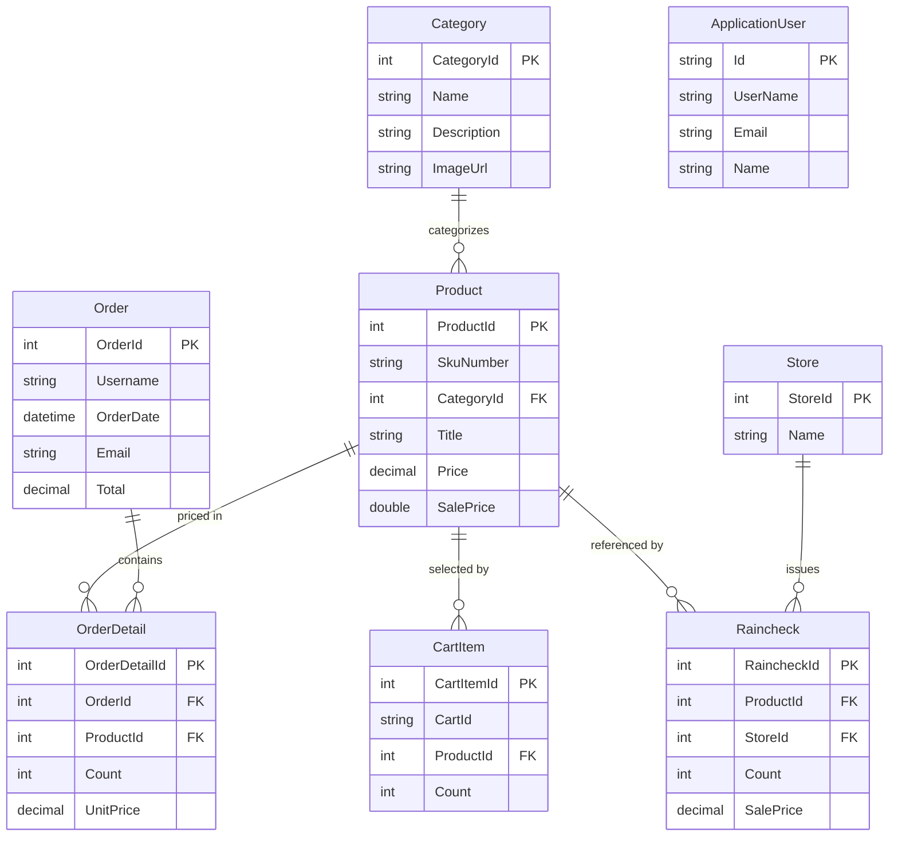

# Data Architecture & Persistence Layer

Caldova Asset Manager uses EF Core over SQL Server for its application and identity records, with a separate in-memory EF provider in the hosting tests. Its model centers on products, customer orders, session carts, categories, stores, and rainchecks.

## Database Configuration

| Service/Module | DB Type | Profile | Driver | Connection | Migration Tool |
|---|---|---|---|---|---|
| Website | SQL Server | Runtime/default | Microsoft.EntityFrameworkCore.SqlServer 10.0.0 | Externally configured `ConnectionStrings:DefaultConnectionString` or `SQLCONNSTR_DefaultConnectionString`; no checked-in connection string | EF Core migrations are present; runtime uses the configured database |
| Hosting tests | EF Core InMemory | Test | Microsoft.EntityFrameworkCore.InMemory 10.0.0 | Test-created in-memory database | Test fixture setup |

The application does not declare separate database profiles. The EF Core context maps the application entities and ASP.NET Identity data to the existing SQL schema.

## Data Ownership per Service

| Service | Tables Owned | ORM Framework | Caching | Notes |
|---|---|---|---|---|
| Caldova-Asset-Manager.Website | Products, Categories, CartItems, Orders, OrderDetails, Rainchecks, Stores and ASP.NET Identity tables | EF Core 10 | In-process MemoryCache; in-memory session | One shared SQL Server database/context |

## Entity Model

The entity declarations are in `IaaS2PaaSWeb/Caldova-Asset-Manager.Website/Models/`. `CaldovaAssetManagerContext` configures the table mappings and explicit raincheck-to-store and decimal precision mappings. Order ownership is represented by the `Username` value; no EF navigation foreign key to `ApplicationUser` is configured.

## Key Repository Methods

| Service | Repository | Notable Methods | Purpose |
|---|---|---|---|
| Website | `OrdersQuery` (`Utils/OrdersQuery.cs`) | `IndexHelperAsync`, `FindOrderAsync`, `FillOrderDetails` | Retrieves date/user-filtered orders and loads line items and products |
| Website | `RaincheckQuery` (`Utils/RaincheckQuery.cs`) | `GetAllAsync`, `FindAsync`, `AddAsync`, `FillRaincheckValuesAsync` | Reads rainchecks, enriches them with store/product/category data, and persists new records |
| Website | `StringContainsProductSearch` (`ProductSearch/StringContainsProductSearch.cs`) | `Search`, `Depluralize` | Searches product titles using a derived EF query |
| Website | `ICaldovaAssetManagerContext` | EF `DbSet` properties and `SaveChangesAsync` | Shared persistence abstraction used by controllers and services |

## Caching Strategy

Product details, latest product, top-selling products, and new arrivals use `System.Runtime.Caching.MemoryCache.Default` with approximately ten-minute expiration. ASP.NET Core session uses the in-memory distributed-cache implementation for the cart identifier. The cache and session are process-local; no Redis or other distributed provider is configured.

## Data Ownership Boundaries

The single website owns all application and identity records in one SQL Server database. Controllers and query services use the shared EF context; there is no database-per-service or cross-service direct database access. The optional recommendation endpoint receives a product identifier and returns recommendation identifiers, which are joined back to locally owned products.

### Data Classification & Sensitivity

| Entity | Sensitive Fields | Classification (PII/PHI/PCI/None) | Controls in Place |
|---|---|---|---|
| ApplicationUser | UserName, Email, Name | PII | No field-level encryption or masking is configured in the application |
| Order | Name, Address, City, State, PostalCode, Country, Phone, Email, Username | PII | No field-level encryption or masking is configured in the application |
| OrderDetail | ProductId, Count, UnitPrice, OrderId | Purchase history | Access is scoped by application authorization and order ownership checks |
| CartItem | CartId, ProductId, Count | Session-linked commerce data | Session cookie is HttpOnly; session storage is in process |

No PHI or PCI fields were identified in the entity model. Encryption at rest is not configured by application code and depends on the SQL Server hosting environment.
