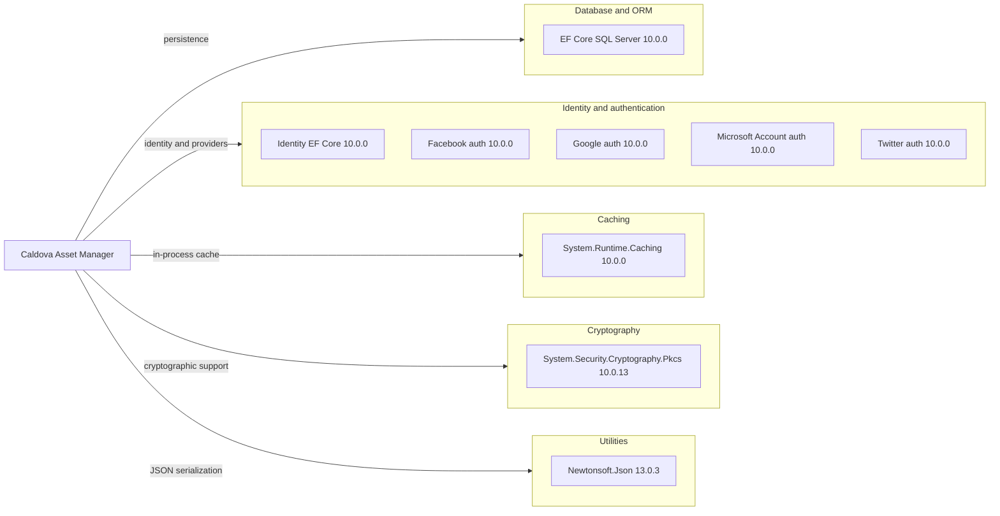

# Dependency Map

Caldova Asset Manager declares 9 production package dependencies in its .NET web project. Its hosting test project adds 5 test-scoped packages, listed separately below.

## Dependencies

### Dependency Summary

| Category | Count | Key Libraries | Notes |
|---|---:|---|---|
| Database and ORM | 1 | EF Core SQL Server 10.0.0 | SQL Server provider |
| Identity and authentication | 5 | ASP.NET Core Identity EF Core and four OAuth provider packages, all 10.0.0 | Provider use is configuration-gated |
| Caching | 1 | System.Runtime.Caching 10.0.0 | In-process cache |
| Cryptography | 1 | System.Security.Cryptography.Pkcs 10.0.13 | Cryptographic support |
| Utilities | 1 | Newtonsoft.Json 13.0.3 | JSON dictionary and recommendation-response parsing |

### Version & Compatibility Risks

The app targets .NET 10 and declares .NET 10-era ASP.NET Core and EF Core packages. Newtonsoft.Json 13.0.3 is the only production dependency on an earlier major-version line; the dependency scan found no applicable advisories for the assessed test project at the configured high-severity threshold.

### Notable Observations

- Authentication provider libraries are included, but provider configuration is disabled unless explicitly enabled.
- SQL Server is the only production database provider declared in the web project.
- The production project does not declare a message-broker, distributed-cache, or service-discovery client.

## Test Dependencies

| Framework | Version | Notes |
|---|---|---|
| Microsoft.AspNetCore.Mvc.Testing | 10.0.0 | In-process host testing |
| Microsoft.EntityFrameworkCore.InMemory | 10.0.0 | In-memory database provider for tests |
| Microsoft.NET.Test.Sdk | 17.14.1 | Test discovery and execution |
| xunit | 2.9.3 | Test framework |
| xunit.runner.visualstudio | 3.1.4 | Visual Studio test adapter |

Total test-scope dependencies: 5

The test project uses xUnit and an ASP.NET Core test host with an in-memory EF Core provider. No separate mocking or contract-testing package is declared.
